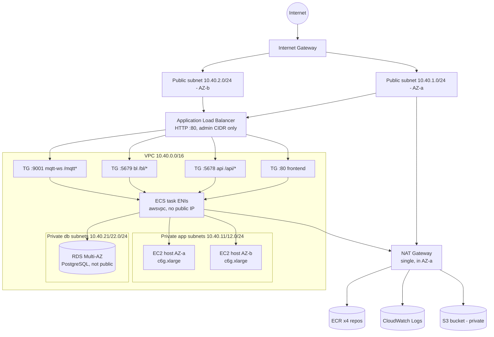

# four-service-ecs-terraform

AWS ECS-on-EC2 test architecture for **learning and architecture validation**.
Four independent services — Frontend, API, Business Logic (BL), MQTT — on one
ECS cluster backed by two `c6g.xlarge` (Graviton/arm64) EC2 container hosts,
behind an internet-facing ALB, in `ap-south-1`.

> This is a **test environment**, not production. The sample containers are
> placeholders; see [Limitations](#limitations) before believing anything works.

---

## Architecture



- One VPC, DNS support + hostnames on, 2 AZs discovered dynamically.
- Subnets: `10.40.1|2.0/24` public, `10.40.11|12.0/24` app, `10.40.21|22.0/24` db.
- One ECS cluster, one ASG (min=desired=max=2), one ASG capacity provider.
- ALB HTTP :80 → `/`=frontend, `/api/*`=api, `/bl/*`=bl, `/mqtt*`=mqtt WebSockets.
- 4 desired tasks total (1 per service). Spread across AZs and instances.

## Sample images

| Service | Image | Port | arm64 | Response |
|---|---|---|---|---|
| Frontend | `nginx:1.29.8-alpine` | 80 | yes (multi-arch) | nginx welcome page |
| API | `ealen/echo-server:0.9.2` | 5678 | yes | JSON echo, `SERVICE_NAME=api` |
| BL | `ealen/echo-server:0.9.2` | 5679 | yes | JSON echo, `SERVICE_NAME=bl` |
| MQTT | `eclipse-mosquitto:2.0.22` | 1883 (TCP) + 9001 (WS) | yes | MQTT broker |

API and BL are the same image on different ports with a different `SERVICE_NAME`
env var — distinguishable, but **not** real API/business-logic implementations.

## Prerequisites (PowerShell)

```powershell
# 1. Terraform >= 1.6
terraform --version
# Install: winget install HashiCorp.Terraform   (or download + add to PATH)

# 2. AWS CLI v2
aws --version
# Install: winget install Amazon.AWSCLI

# 3. Credentials - use an IAM user/role with admin-ish rights for this test.
aws configure
#   Access key / secret / region: ap-south-1 / output: json
aws sts get-caller-identity   # sanity check

# 4. An existing EC2 key pair for the container hosts.
#    This project defaults to the existing key pair "sunroof-key".
#    (Override with key_pair_name in terraform.tfvars if yours differs.)
```

## Deploy

```powershell
cd four-service-ecs-terraform

# Create local tfvars and EDIT it: set allowed_admin_cidr to YOUR public IP/32.
Copy-Item .\terraform.tfvars.example .\terraform.tfvars
notepad .\terraform.tfvars
# Find your IP: (Invoke-RestMethod -Uri "https://checkip.amazonaws.com").Trim()

# DB password via env var - NEVER committed:
$env:TF_VAR_db_password = "replace-with-a-strong-unique-password"

terraform init
terraform fmt -recursive
terraform validate
terraform plan            # REVIEW THIS
terraform apply           # type 'yes' - creates real, billable resources
```

Or use the helper which does all of the above and asks before applying:

```powershell
.\scripts\deploy.ps1
```

## Test

```powershell
.\scripts\test-services.ps1
```

Or manually:

```powershell
$alb = terraform output -raw alb_dns_name
curl "http://$alb/"        # nginx welcome page
curl "http://$alb/api/"    # echo-server JSON (SERVICE_NAME=api)
curl "http://$alb/bl/"     # echo-server JSON (SERVICE_NAME=bl)

# ALB target health
aws elbv2 describe-target-groups --query "TargetGroups[].TargetGroupArn" --output text |
  ForEach-Object { aws elbv2 describe-target-health --target-group-arn $_ --output table }

# ECS tasks
aws ecs list-services --cluster four-svc-test-cluster --output table
aws ecs list-tasks --cluster four-svc-test-cluster --output table

# CloudWatch logs (one group, per-service prefixes)
aws logs describe-log-streams --log-group-name /ecs/four-svc-test --output table
```

Note: an ALB health check only decides whether a target gets traffic. It does
**not** restart tasks — ECS restarts/replaces containers based on the
*container* health check and the service scheduler.

### Testing MQTT

- **WebSockets**: use an MQTT client that supports `ws://` — e.g. MQTT.js,
  MQTT Explorer, or `mqttx`. Broker URL: `ws://<alb_dns>/mqtt`, no auth
  (anonymous allowed — demo only, never connect real devices).
- **Native TCP 1883**: *not* reachable through the ALB — an Application Load
  Balancer speaks HTTP/WebSockets, not raw TCP. The 1883 listener is only
  reachable inside the VPC (task SG self-rule). If you need real TCP from the
  internet, that's what an NLB is for — deliberately not included here.
- Quick smoke test without extra tooling: the ALB `/mqtt*` rule + TG health
  check confirms the WS port answers; a full pub/sub test needs a WS client.

## Security notes

- ALB is **HTTP-only** — demo configuration. Production needs HTTPS + ACM cert.
- `allowed_admin_cidr` has **no default** — you must set it (your IP/32) before
  anything is reachable from the internet.
- ECS hosts are private, no public IP, SSH :22 open **inside the VPC only**
  (key pair `sunroof-key` attached; SSM is intentionally not used).
- RDS: Multi-AZ, `gp3`, encrypted, `publicly_accessible=false`, DB subnets have
  no internet route, SG allows the DB port **only from ECS task ENIs**.
- S3: private, all public-access blocks on, versioning + AES256 on. The sample
  containers do **not** use it — provisioned for later integration, no task
  IAM permissions granted for it.
- ECR: 4 repos, `scan_on_push`, MUTABLE tags (dev convenience), untagged images
  expire after 7 days. Creating repos does not build/push images — push your
  own and repoint `frontend_image`/`api_image`/`bl_image`/`mqtt_image`.
- Secrets: `db_password` is a sensitive variable via `TF_VAR_db_password`;
  nothing secrets-shaped is committed.

## Cost

Real ongoing charges — set an **AWS Budget** first. Verify current prices for
`ap-south-1` in the pricing pages; do not trust estimates from any doc:

- 2× `c6g.xlarge` On-Demand EC2 + EBS gp3
- ALB hourly + LCU
- NAT Gateway hourly + per-GB processing
- Public IPv4 addresses (EIP + ALB IPs)
- Multi-AZ RDS (`db.t4g.micro` default) + storage + backups
- CloudWatch logs (+ Container Insights if enabled — off by default)
- S3 + ECR storage/requests

## Destroy

```powershell
.\scripts\destroy.ps1     # asks for 'destroy' confirmation, runs terraform destroy
```

If destroy fails on the S3 bucket, empty it first (versioning leaves delete
markers — delete all versions).

## Limitations — read this

1. 4 services × desired 1 = **4 tasks total**, not 8.
2. ECS does not guarantee a task's host or AZ. The `spread` placement
   strategies (AZ, then instanceId) are best-effort, not placement
   *constraints* — with 1 task/service they matter mostly for rescheduling.
3. If one EC2 host fails, ECS can reschedule tasks on the survivor only if
   capacity + placement allow. Our 4 tasks fit on one host (1 CPU / 2 GiB of
   ~4 vCPU / ~7.5 GiB), so they likely will — but this is not HA.
4. Two EC2 hosts ≠ every service stays up during a host failure.
5. RDS Multi-AZ covers the **database**; it does nothing for app availability.
6. API and BL are echo-server placeholders — no real business logic.
7. The frontend does **not** proxy to API/BL; the services never call each
   other. No service discovery is configured (add Service Connect/Cloud Map
   only if real apps need it). Private inter-task networking *is* possible
   within the VPC — don't confuse "possible" with "implemented".
8. Native MQTT/TCP 1883 **cannot** go through the HTTP ALB. Only the WS
   listener (9001) is exposed at `/mqtt*`. Needs a WS-capable client.
9. HTTP-only ALB is a test shortcut; real deployments need HTTPS.
10. Samples don't touch RDS or S3 — nothing reads/writes the DB or bucket.
11. Single NAT = single point of dependency for outbound + cross-AZ data
    transfer charges. Per-AZ NAT is the resilient (costlier) option.
12. Images are pinned by tag, not digest — tags can be repushed upstream.
    For stricter pinning, use `image@sha256:...` digests.
13. `db.t4g.micro` Multi-AZ + `engine_version 16/8.0` chosen as smallest
    sensible Graviton class — verify availability/price in ap-south-1.
14. Mosquitto runs `allow_anonymous true` — acceptable for a demo broker
    behind a restricted ALB, never for real clients.

## File map

```
versions.tf / provider.tf / variables.tf / locals.tf
networking.tf        VPC, subnets, IGW, NAT, route tables
security-groups.tf   ALB / host / task / RDS security groups
alb.tf               ALB, 4 target groups, listener + rules
ecs-cluster.tf       cluster (+ Container Insights toggle)
ecs-capacity.tf      AMI lookup, launch template, ASG, capacity provider
iam.tf               instance role + task execution role
ecs-task-definitions.tf / ecs-services.tf
rds.tf / s3.tf / ecr.tf / logging.tf / outputs.tf
scripts/deploy.ps1 / test-services.ps1 / destroy.ps1
```

## Validation performed

Done locally on Windows, Terraform 1.16.1, AWS provider 5.100.0:

- `terraform fmt -recursive` — clean
- `terraform init -backend=false` — success
- `terraform validate` — success
- `terraform plan` (with placeholder vars, read-only) — **77 to add, 0 errors**;
  AMI data source resolved to `ami-06e44b9cf7b60a79f`
  (`al2023-ami-ecs-hvm-2023.0.20261022-kernel-6.1-arm64`), key pair
  `sunroof-key` confirmed to exist in ap-south-1
- Image arch/tags verified against Docker Hub: `nginx:1.29.8-alpine`,
  `ealen/echo-server:0.9.2`, `eclipse-mosquitto:2.0.22` all publish arm64
- No `terraform apply` was run — a live deploy test still needs to happen in
  your account.
